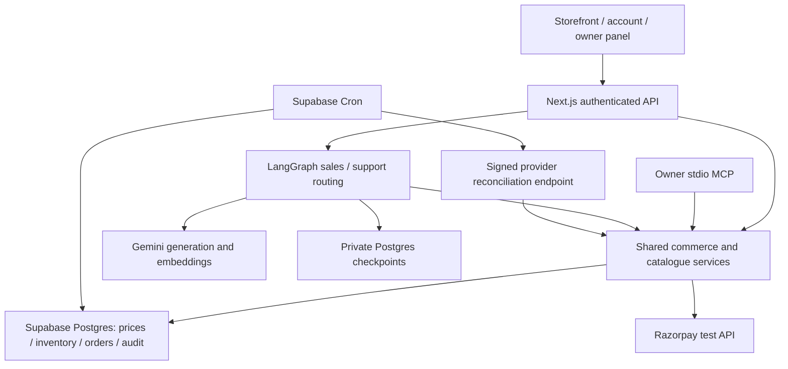

# Architecture and decisions

Next.js serves the storefront, account, owner dashboard, and HTTP adapters. React components call a single API route adapter; it supplies a verified actor to shared TypeScript services. The local owner MCP server and LangGraph tools call those same services. There is no second commerce implementation inside an agent.

## Money and inventory

Money is integer paise, weight is integer milligrams, percentage charges are basis points. SQL `calculate_price` is authoritative; a matching BigInt implementation verifies arithmetic. Metal/making/tax boundaries use specified half-up rounding. The sample 4.2g 22K example is exactly ₹44,332.85. Browse cards may round for display; quotes, receipts, and refund decisions retain paise.

Quotes freeze product facts, current-day rates, and amounts for 15 minutes. Checkout locks sorted product rows and acquires the whole cart atomically, with an idempotency key bound to actor and quote. Provider order creation follows the transaction so network calls never hold inventory locks open.

Reservations are a separate one-piece flow above ₹25,000. A confirmed ₹1,000 test capture extends the hold to 48 hours and generates a reservation code. Counter conversion preserves the frozen price and records the remaining balance after the token. Purchases and reservation conversions are counted separately.

Payment confirmation verifies provider identity, captured status, amount, and currency. Browser callback signatures are followed by a provider lookup; webhook signatures cover the exact raw body. An event receipt and its effects commit atomically. Duplicate events do not duplicate sales. Late captures reacquire every piece or enter an exception queue. Expiry locks orders before products to avoid an order/product deadlock with late capture.

Refund requests are bounded by actual captured value less prior refunds, including exception captures. Owner decisions, provider submission, uncertain outcomes, reconciliation, and confirmed processing are distinct states. The persisted request identity is reused across retries. A refund never automatically restocks sold physical jewellery; the owner must inspect and explicitly restock it.

## AI, search, and review

The approved plan selected Gemini 3.1 Flash-Lite. Its free daily quota was exhausted during verification. The configured primary is now **Gemini 3.5 Flash-Lite**, verified against Google's published free-tier availability and tested with actual tool calls. This is a fixed model selection; no paid fallback is enabled. Reports retain their real model IDs.

Keyword retrieval uses weighted full text with normalized Hinglish terms. Gemini Embedding 2 text and image vectors have 768 dimensions and explicit model/revision metadata. Hybrid retrieval combines ranks with reciprocal rank fusion. Availability, purity, and canonical-price filters precede final candidate selection. At 50 products exact vector search is sufficient; another search service or approximate index would add complexity without demonstrated benefit.

The sales agent can recommend, quote, and prepare customer review links. Support can retrieve policy/order facts, request approval, and flag a human handoff. Neither can execute owner refunds, change rates, claim payment, or choose identity. Inputs are Zod validated. Hard budgets/purity are enforced by code across search, quote, checkout review, and reservation suggestions. A turn allows at most six tool calls and holds a conversation lease beyond the route's maximum duration.

LangGraph checkpoints live in a private schema. Refund approval uses an independent durable graph so pausing approval does not interrupt ordinary chat. Reference image bytes stay outside checkpoint state. Published product-card references are refreshed from the catalogue for follow-up questions. Generated monetary prose is rejected; cards and quotes show server-backed values. Progress events stream first, followed by validated final content.

Extraction produces an editable draft; unknown weight, purity, and hallmark fields stay unverified. Publishing requires explicit financial-field and hallmark review. Browser photos are resized to 1600px and compressed to at most 2MB before upload. Failed embeddings are visible and retryable; CSV imports stage drafts and report duplicates instead of overwriting live stock.

## Access and operations

Server Auth uses verified Supabase users and database profiles for roles. User-editable metadata never grants a role. RLS restricts customer records; server-only tables deny direct client access. Secret keys and management tokens are absent from browser bundles. Public product DTOs omit vectors and extraction internals. Remote database TLS verifies the full certificate chain and hostname.

Supabase Cron expires holds in SQL and invokes reconciliation with a timestamp/path-bound HMAC and unique nonce. The reusable key stays in Vault; the public queue contains no reusable credential. The endpoint rejects expired/replayed signatures and uses a durable batch lease. Reconciliation only verifies existing provider state; it cannot approve a refund.

The intentionally narrow stdio MCP server inherits the local owner's database credentials and derives the owner from the database. It offers search, quote, rate, mark-sold, and sales-summary tools, with explicit mutation confirmations and large-rate-change review. A public remote MCP endpoint is outside the agreed transport scope.
