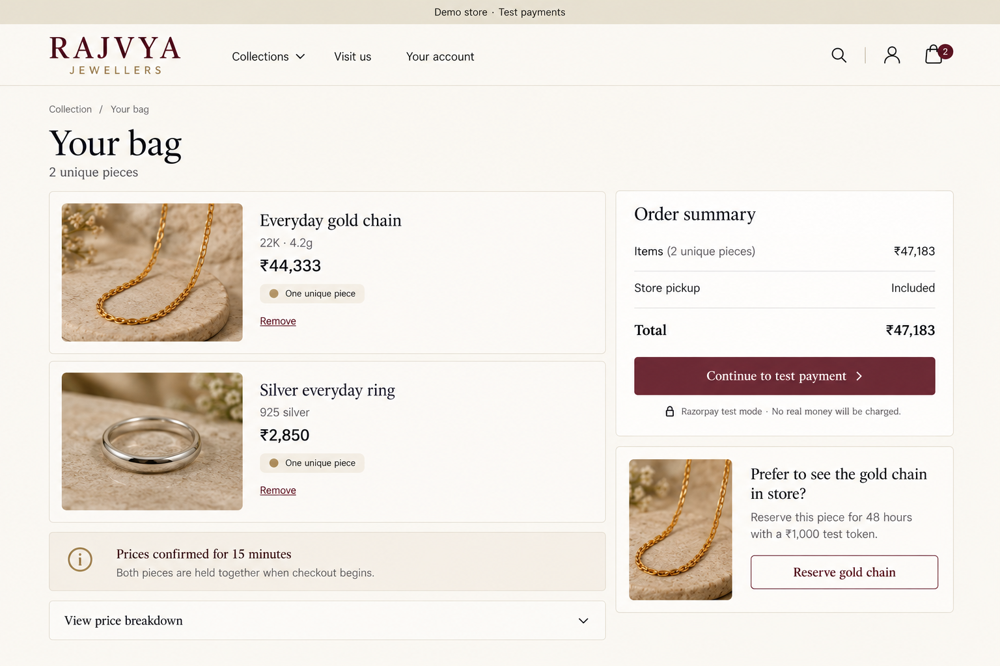
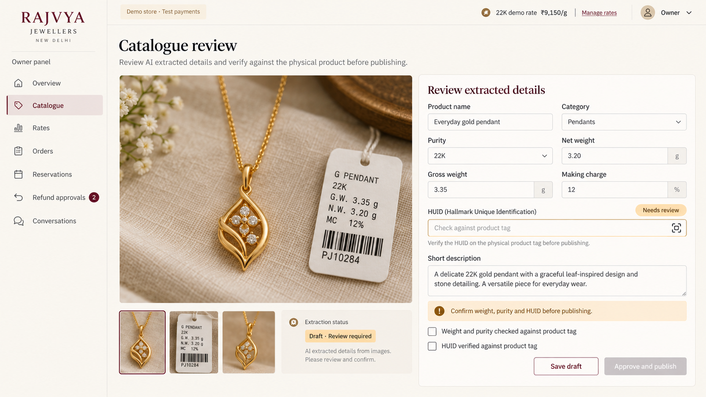
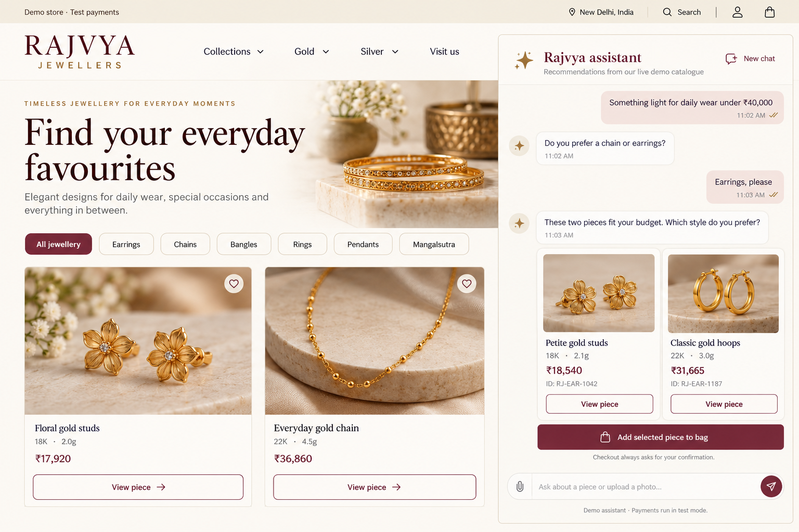

# Rajvya: end-to-end build roadmap

## 1. Goal and architecture

Build a deployed jewellery-store portfolio project covering the guide’s complete feature set: catalogue, daily pricing, multi-item checkout, reservations, AI-assisted uploads, conversational shopping, support, refund approvals, evaluations, and owner tools.

**Build the store first, then connect the AI to its tested business functions.** The assistant may choose actions and explain results; prices, inventory, permissions, and payments remain controlled by code.

The workspace is currently empty. This plan assumes basic React/TypeScript knowledge, free service tiers, sample data initially, and a reviewed import of actual shop data later. Progress is measured by completion gates rather than calendar estimates.

```text
Storefront + cart + chat        Owner dashboard
             │                       │
             └────── Next.js ────────┘
                        │
              Shared business services
       catalogue · pricing · inventory · orders
           payments · reservations · refunds
                 │                 │
          Supabase/Postgres    Razorpay test mode
                 │
       Search + LangGraph + Gemini
                 │
       Owner MCP tools reuse the same services
```

This is one application with clear internal modules. A separate backend, Redis, and a separate vector database add little value at this scale.

## 2. Tech stack and reasons

| Area | Decision | Reason and tradeoff |
|---|---|---|
| Application | **Next.js App Router + React + TypeScript**, Node.js server runtime | One language and deployment for storefront, admin, and APIs. Server-rendered product pages support discovery; interactive components handle cart and chat. A separate FastAPI/Express service would add deployment work. |
| UI | **Tailwind CSS + shadcn/ui** | Accessible building blocks speed up forms, dialogs, tables, and mobile layouts while allowing a jewellery-specific design. |
| Validation | **Zod** | Validate browser requests, AI tool inputs, and extraction results at runtime. TypeScript alone cannot validate external data. |
| Database | **Supabase Postgres**, SQL migrations, generated TypeScript types | Transactions protect unique stock; relational tables suit orders and refunds. Use Supabase’s client for routine access and SQL functions for atomic operations. No additional ORM initially. |
| Identity and images | **Supabase Auth + Storage** | Reuse the database platform. Pre-provision demo accounts with email/password so the portfolio does not depend on SMS or outgoing email delivery. |
| Search | **Postgres full-text search + pgvector**, combined using Reciprocal Rank Fusion | Keywords handle exact jewellery terms; vectors handle meaning and Hinglish. Keep filters and inventory in the same database. Start with exact vector search at this catalogue size. |
| AI | **Gemini 3.1 Flash-Lite**, accessed through a small provider adapter | Matches the guide and supports the intended low-cost workflow. Keep model IDs configurable and store the model version with evaluation results. |
| Embeddings | **Gemini Embedding 2, 768 dimensions**, separate text and image vectors | Supports text and photo search in a shared embedding space. Record model and dimension metadata so later changes trigger re-embedding. [Google documentation](https://ai.google.dev/gemini-api/docs/embeddings) |
| Agent workflow | **LangGraph.js + Postgres checkpoints** | Explicit routing, persisted conversations, and approval pauses fit this project. Use it for conversation orchestration; catalogue extraction stays a fixed pipeline. [Interrupt documentation](https://docs.langchain.com/oss/javascript/langgraph/interrupts) |
| Payments | **Razorpay Standard Checkout, test mode** | Demonstrates the intended Indian payment integration without collecting real money. Browser callbacks improve UX; verified provider events and reconciliation establish payment status. |
| Background work | **Supabase Cron** for database expiry; **GitHub Actions** for evaluation runs | Database cleanup belongs near the inventory. Long evaluation suites should run outside an HTTP request. Supabase Cron can execute database functions directly. [Documentation](https://supabase.com/docs/guides/cron) |
| Testing | **Vitest + real Postgres integration tests + Playwright** | Unit tests prove arithmetic; database tests prove transactions and permissions; browser tests prove complete journeys. |
| Deployment and diagnostics | **Vercel Hobby**, structured logs, database audit records, optional LangSmith tracing within its allowance | Suitable for the personal demo. Trace IDs, tool calls, latency, and token usage remain available even without an external tracing service. |

**Free-tier constraints shape the implementation.** Google currently lists free access for the chosen chat and embedding models, subject to quotas; requests must stop or degrade gracefully when those quotas are exhausted. Free-tier data handling also means customer personal information should stay out of model inputs. [Google pricing and data-use information](https://ai.google.dev/gemini-api/docs/pricing)

Vercel Hobby permits personal, non-commercial use and cannot run five-minute cron jobs. A real-shop launch requires reviewing hosting eligibility and budget separately. [Hobby terms](https://vercel.com/docs/plans/hobby), [cron limits](https://vercel.com/docs/cron-jobs/usage-and-pricing)

## 3. Build order and completion gates

### Milestone 1 — Define the domain and establish the foundation

**Build**

- Initialize the application, formatting, linting, type checks, environment validation, and CI.
- Set up local Supabase and versioned migrations; deploy a minimal preview early.
- Define customer, staff, and owner permissions.
- Seed approximately 50 varied products with owned or licensed images, fictional policies, and clearly labelled demo rates.
- Write initial acceptance scenarios before implementing commerce or AI.

**Gate:** A fresh checkout can start locally, reset its database, run checks, and deploy without undocumented manual steps.

**Why first:** Every later feature depends on reproducible data, clear permissions, and working infrastructure.

### Milestone 2 — Pricing, inventory, and manual owner operations

**Build**

- Products, images, versioned metal rates, charges, and publication states.
- One canonical database pricing function used by listing filters, product pages, quotes, and checkout.
- Store money as integer paise; weights as integer milligrams; percentage charges as basis points. Specify rounding at each calculation boundary.
- Owner screens to set rates and manually create, edit, publish, or mark products sold.
- Require an explicit rate update for the current shop day before issuing new quotes; otherwise display prices as unavailable.
- Keep rate history and audit records for sensitive changes.

**Gate:** The guide’s worked pricing example passes, changing a rate updates unquoted prices, and unauthorized users cannot alter rates or stock.

**Why before AI:** This establishes the facts that every shopping channel must share.

### Milestone 3 — Storefront, accounts, and multi-item cart


**Build**

- Mobile-first catalogue, product details, price breakdowns, keyword search, and category/purity/budget filters.
- A browser-persisted cart containing product IDs; quantity is one for each unique piece.
- Customer login, account pages, and server-side authorization.
- Clear unavailable, held, sold, stale-price, and empty-result states.
- Separate owner dashboard access from customer access.

**Gate:** A customer can browse, filter, inspect prices, and build a multi-item cart. Editing browser prices has no effect on server calculations.

**Why here:** This produces a useful store and exercises the domain before payments complicate debugging.

### Milestone 4 — Quotes, atomic holds, and checkout



**Build**

- Immutable item-level price snapshots grouped into a cart quote, valid for 15 minutes.
- A database transaction that locks all requested products in a consistent order and acquires every hold or none.
- Repeated checkout requests reuse the same attempt through an idempotency key.
- Create the Razorpay order after committing the database transaction; never hold database locks during network calls.
- Track provider-order creation failures and uncertain responses for reconciliation.
- Verify callback and webhook signatures, provider order identity, amount, currency, and captured payment status.
- Record webhook receipt and its database effects atomically; duplicates cannot skip unfinished processing.
- Add expiry cleanup and direct expiry checks during availability reads.
- Separate payment status from fulfilment status.

**Gate:** Two customers racing with overlapping carts cannot buy the same piece. Closing the browser after payment still produces a paid order.

**Critical exception:** A payment captured after a hold expires must reacquire all required inventory atomically or enter a paid-exception queue. It must never claim unavailable stock or disappear as a failed order.

**Why before conversational checkout:** Payments must work through normal buttons before an agent can invoke them.

### Milestone 5 — Reservations, fulfilment, and refunds through the dashboard

**Build**

- One-piece reservations, separate from purchase carts, for demo-priced pieces above ₹25,000.
- A ₹1,000 test token payment converts a short checkout hold into a 48-hour reservation after confirmed capture.
- Reservation code, visit time, counter lookup, and recorded conversion to an in-store sale.
- Freeze the quoted item price for the demo reservation period; deduct the token from its balance.
- Staff-managed fulfilment and tracking fields; no carrier integration.
- Owner-approved refunds for whole orders or selected order items, bounded by captured value minus previous refunds.
- Reservation cancellation/expiry creates a refund request for owner review.
- Refund processing and physical restocking remain separate decisions.

**Gate:** Reservation payment, expiry, counter conversion, partial refund, rejection, and repeated approval are all demonstrable.

**Why now:** The later support agent will reuse these operations instead of creating a second refund implementation.

### Milestone 6 — AI catalogue intake and reviewed imports



**Build**

- Upload photo → extract structured fields → review → approve → publish.
- Treat extraction confidence as a review hint, not proof of accuracy.
- Require explicit review of weight, purity, charges, and HUID; leave unreadable fields blank.
- Generate English/Hindi descriptions and tags without inventing product properties.
- Create embeddings from approved content; failed indexing leaves a visible retryable status.
- Add CSV import with validation, duplicate-SKU detection, and draft staging for actual shop data.

**Gate:** Staff can correct an extraction, publish a product, retry a failed embedding job, and import data without overwriting live inventory silently.

### Milestone 7 — Hybrid search and photo search

**Build**

- Compare keyword-only, vector-only, and combined retrieval.
- Apply publication, current availability, purity, and computed-price filters before selecting final candidates.
- Add Hinglish synonym fixtures and image-query search.
- Return no exact match when constraints cannot be met; offer alternatives only with clear permission to relax constraints.
- Create a labelled search dataset covering English, Hinglish, and photos.

**Gate:** Record relevance results for all three methods and prove budget/purity constraints are never silently relaxed.

**Measurement correction:** “At least one relevant item in the top five” is **Hit@5**. Report Recall@5 separately when queries have multiple labelled relevant products.

### Milestone 8 — Shopping and support assistant



**Build**

- First connect one agent to the existing services; measure this baseline.
- Add sales/support routing with separate tool permissions and compare against the baseline.
- Implement recommendations, matching pieces, quotes, cart actions, checkout initiation, reservations, policy retrieval, order status, refund requests, and human handoff.
- Require a customer click to confirm payment initiation or other consequential customer actions.
- Persist conversation state and enforce ownership on every read, write, and resume.
- Limit each turn to six tool calls, serialize concurrent turns per conversation, and summarize older context.
- Add durable refund approval pauses; resume through an authenticated owner action.
- Keep refund side effects idempotent because resumed graph nodes can execute again.
- Stream progress events, then validated answers. Prices appear through structured product/quote components; reject unsupported monetary claims before displaying generated prose.
- Add per-user throttling, a global daily AI-call cap, bounded retries, and a clear quota-exhausted fallback to the normal store.

**Gate:** A customer can complete shopping and support journeys through chat while all money and inventory rules remain enforced by the same services.

### Milestone 9 — Owner MCP tools and operational views

**Build**

- Expose catalogue search, quotes, rate updates, mark-sold, and sales summary using the official TypeScript MCP SDK.
- Use **local stdio transport** for the portfolio owner integration. This demonstrates tool reuse without introducing public remote authentication.
- Bind credentials to an owner identity; never accept roles or customer identity supplied by the model.
- Require an explicit confirmation step for mutations and owner review for unusually large rate changes.
- Add dashboard queues for human handoffs, failed payments/refunds, and unprocessed events.
- Report purchases and reservation conversions separately so one customer journey is not double-counted.

**Gate:** MCP and dashboard actions enforce identical permissions, validation, and audit logging.

Remote `/api/mcp` deployment is a later compatibility extension requiring the chosen client’s authentication flow. The portfolio includes the owner-tool capability through local MCP. [MCP server documentation](https://modelcontextprotocol.io/docs/develop/build-server)

### Milestone 10 — Evaluation, hardening, and portfolio release

**Build**

- Grow the initial fixtures into the guide’s 100-scenario suite: 40 sales, 25 support, 15 Hinglish/vague, and 20 attacks.
- Run deterministic tool, state, permission, and recorded-response tests on PRs.
- Run a 30-case **live** evaluation before releases and the full suite manually in quota-sized batches. Record quota failures as incomplete runs.
- Add a separate quality-judge pass, calibrated against 50 human-reviewed conversations. Treat its scores as advisory until agreement is measured.
- Store commit, prompt version, model, dataset version, results, token usage, and latency.
- Test restart recovery, service failures, data reset, image restrictions, secret handling, and database access policies.
- Publish a README, architecture explanation, setup guide, demo script, measured results, and known limitations.
- Conduct a supervised demo-review period before enabling unrestricted assistant replies.

**Gate:** A reviewer can reproduce the project and demonstrate every main journey. All safety-critical tests pass, and reported AI results come from identifiable runs.

## 4. Core interfaces and verification

The main persistent records are products/images/rates; quotes and quote items; holds and hold items; orders and order items; payment attempts/events; reservations; refund requests/items/attempts; conversations/checkpoints; policies; audit logs; and evaluation runs.

Shared service contracts cover:

- `searchCatalog(filters)` and `getQuote(productIds)`.
- `createCheckout(quoteId, idempotencyKey)` and `createReservation(productId, visitTime, idempotencyKey)`.
- `getOrderStatus(orderId)` and `requestRefund(orderId, itemIds, reason)`.
- Owner-only rate, inventory, fulfilment, and approval operations.

Authenticated identity is supplied by trusted server context. Every interface returns structured results and explicit errors. Browser routes, agent tools, and MCP adapters call these same services.

The release test suite must include:

| Area | Required scenarios |
|---|---|
| Pricing | Fractional weights, fixed/percentage making charges, rounding, missing rates, expired quotes, rate changes after quoting. |
| Inventory | Overlapping carts, all-or-nothing holds, expiry, checkout retries, and counter sale racing with online checkout. |
| Payments | Forged signatures, duplicate/out-of-order events, provider timeout, closed browser, late capture, and reconciliation. |
| Refunds | Item-level refunds, refund limits, repeated approval/resume, provider uncertainty, and no automatic restocking. |
| Access | Other customers’ orders/conversations, customer attempts at owner actions, and direct database access under RLS. |
| AI | Unsupported prices, prompt injection, strict budgets, policy grounding, tool loops, quotas, and durable approval recovery. |

AI quality targets start at **85% task success** and **85% Hit@5** on the project’s labelled datasets, with zero successful authorization or payment-integrity attacks. These are release targets, not predicted results. Cost reporting distinguishes actual free-tier spend from estimated paid-tier token cost.

## 5. Defaults and remaining open questions

The portfolio defaults are fixed: one shop, INR, unique pieces, multi-item purchase carts, separate single-piece reservations, simulated fulfilment, test payments, and pre-provisioned demo accounts. Public reviewers receive customer access; owner access stays private. No paid fallback activates automatically.

The document’s GST example is a configurable demo fixture. Its historical dates, customer counts, conversion results, and performance numbers will not be presented as your achievements.

These questions remain for **real data or a commercial launch** and do not block the portfolio:

| Open question | Portfolio default | Must resolve before |
|---|---|---|
| Who authorizes use of Rajvya’s name, photos, and product data? | Clearly labelled sample catalogue; real imports remain drafts. | Publishing actual shop material. |
| What are the approved tax, making-charge, stale-rate, and reservation pricing rules? | Documented sample rules and frozen reservation quotes. | Accepting real money. |
| Which returns, cancellations, reservation-token, and partial-refund policies apply? | Fictional, explicitly labelled policies with owner approval. | Customer-facing commercial use. |
| How will online and counter inventory stay synchronized? | Staff marks counter sales through the dashboard. | Shop rollout; confirm staff can follow this process. |
| Who handles delivery, insurance, invoices, customer communication, and failed payments? | Manual simulated fulfilment and dashboard queues. | Real fulfilment. |
| What budget and provider terms support commercial hosting, authentication, private AI processing, and recovery? | Personal demo on free tiers with bounded availability. | Commercial deployment. |

**First implementation target:** a deployed catalogue and owner panel with correct daily pricing and tested inventory rules. That creates the foundation for every subsequent milestone.

